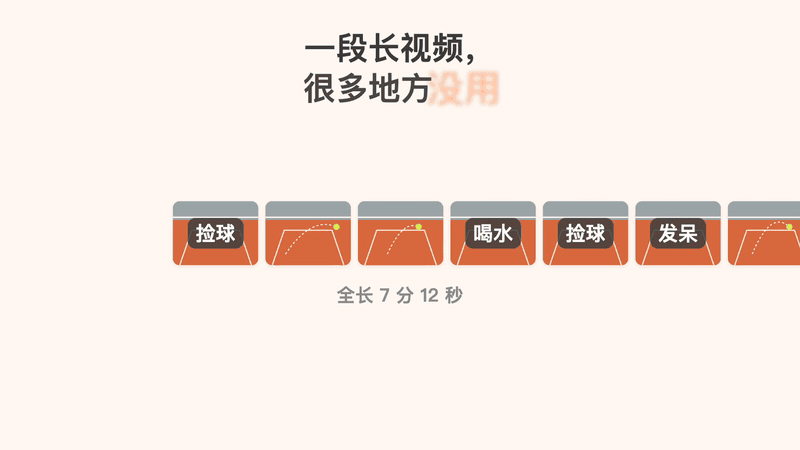

# 网球回合剪辑 · tennis-rally-cut

一段很长的练球视频，自动剪成一个个完整的回合。捡球、走动、休息的部分全部去掉。

宣传片（约 22 秒，无人声）：[横版](media/promo-landscape.mp4) · [竖版](media/promo-vertical.mp4)

## 它做什么

- **一段长视频进去，一个个短视频出来。** 每个回合一个独立视频，原视频不动。
- **一个回合不会被剪碎。** 连续对墙打了 10 拍，就是一个片段，不会拆成几个 2 拍、3 拍。球死了几秒内又接着打，也算同一个回合。
- **没用的自动去掉。** 捡球、走动、停顿、拿手机。
- **先看画质。** 如果视频是被聊天软件压缩过的，它会先提醒你去找原片，免得剪出来是糊的。

对墙练、发球机、对拉都适用。乒乓球、羽毛球、壁球这类击球声清楚的练习视频也可以。

## 怎么用

这是一个给 AI 编程助手用的 Skill，Claude Code 和 Codex 都能用。

1. 把 `tennis-rally-cut/` 文件夹放进 Skill 目录：
   - Claude Code：`~/.claude/skills/`
   - Codex：`~/.agents/skills/`
2. 本机需要装好 `ffmpeg` 和 Python 的 `numpy`。
3. 对助手说一句：「帮我把这个文件夹里的练球视频按回合剪开」。

剪好的视频放在原视频旁边的 `剪辑/` 文件夹里，附一份片段清单。

## 用一次花多少钱

判断回合全在你电脑上算，AI 只负责听懂你的话、跑一条命令、转述结果。两段练球视频（7 分 21 秒 + 3 分 47 秒）剪成 14 个回合，在 Claude Code 里实测一次：

| 模型 | 一次的花费 |
|---|---|
| Haiku 5.5 | 约 0.007 美元（约 5 分钱） |
| Sonnet 5.5 | 约 0.11 美元 |

三档模型剪出的切点完全一样，用最小的模型就够了。

## 关于宣传片

宣传片没有用任何真实的练球画面，全部是动画。片中的数据是虚构的。击球声是用程序合成的，其余音效来自 [Mixkit](https://mixkit.co/)（Mixkit Sound Effects Free License）。

---

**English.** A Claude Code / Codex skill that turns a long tennis practice video into one clip per rally, dropping the ball-picking and walking in between. A rally is never split into pieces. Drop `tennis-rally-cut/` into `~/.claude/skills/` (Claude Code) or `~/.agents/skills/` (Codex), make sure `ffmpeg` and `numpy` are installed, then ask: "cut my practice video into rallies".

## License

MIT
